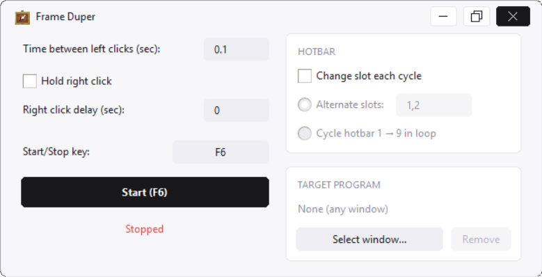

# Frame Duper

<p align="center">
  
</p>

<p align="center">
  
  
</p>

A sleek, modern auto-clicking utility built with Python and Tkinter for Windows. Designed with a clean flat UI, target window detection, custom hotkey toggling, and hotbar slot management.

---

## Features

- **Left Click Automation:** Set a custom interval (in seconds) between left clicks.
- **Right Click Options:**
  - **Hold Mode:** Keeps right-click pressed continuously.
  - **Interval Mode:** Triggers right-click after each left-click with a configurable delay.
- **Hotbar Switcher:**
  - **Alternate Slots:** Automatically switches between designated slots (e.g., `1,2` or `1,3,5`).
  - **Cycle Mode:** Loops through hotbar slots 1 to 9 sequentially.
- **Target Window Focus:** Select a specific program or game window. The script automatically pauses if you switch away from the targeted window.
- **Custom Start/Stop Hotkey:** Bind any key to toggle the auto-clicker (Default: `F6`).

---

## Requirements & Installation

- **Windows 10 / 11**
- **Python 3.8+**

Install required Python packages:

```bash
pip install pynput pillow

```

---

## How to Run

1. Clone or download this repository:
```bash
git clone [https://github.com/axlwhoo/Minecraft-Auto-Frame-Duper.git](https://github.com/axlwhoo/Minecraft-Auto-Frame-Duper.git)
cd frame-duper

```


2. Ensure `logo.png` and `icon.ico` are placed in the project root folder.
3. Run the script:
```bash
python Frame_Duper.py

```


---

## Building Standalone Executable (.exe)

To build a single `.exe` file with embedded assets using PyInstaller:

1. Install PyInstaller:
```bash
pip install pyinstaller

```


2. Compile the executable:
```bash
pyinstaller --noconfirm --onefile --windowed --icon="icon.ico" --add-data "logo.png;." --add-data "icon.ico;." Frame_Duper.py

```


3. The generated `.exe` file will be located in the `dist/` directory.

---
